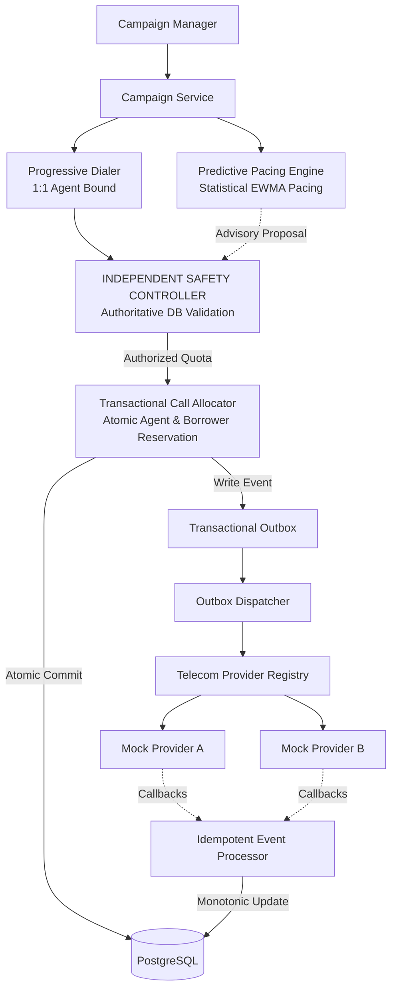

# SmartDialer

[](https://www.oracle.com/java/)
[](https://spring.io/projects/spring-boot)
[](https://www.postgresql.org/)
[](LICENSE)
[]()
[]()

> **A concurrency-safe SmartDialer featuring progressive and predictive dialing, independent safety authorization, transactional agent allocation, idempotent telecom event processing, mock providers and simulation.**

---

## 1. System Overview & Architecture

SmartDialer is a mission-critical outbound dialing platform engineered for debt collections agencies. It improves agent talk-time utilization while maintaining strict compliance safety.

### Core Architectural Invariants:
1. **Mandatory Independent Safety Controller:** Predictive pacing engines are advisory only and can **never** launch calls directly. Every dialing batch passes through an authoritative Safety Controller.
2. **Zero-Orphan Connected Calls:** No connected borrower call may ever exist without an assigned, eligible collections agent. If a borrower answers when no agent is free, the call is safely terminated immediately, a safety incident recorded, and resources cleanly released.
3. **Non-Blocking Post-Commit Telecom Dispatch:** No database transaction is ever kept open while making slow external carrier HTTP/SIP network calls (Transactional Outbox pattern).
4. **PostgreSQL Concurrency Safety:** Atomic conditional updates and row-level locking guarantee that multiple concurrent workers can never double-reserve the same agent or borrower.



---

## 2. Technology Stack

- **Language:** Java 21 LTS
- **Framework:** Spring Boot 3.3.4
- **Persistence:** Spring Data JPA, Hibernate ORM 6.5
- **Database:** PostgreSQL 16 (production), H2 (in-memory test & local standalone)
- **API Documentation:** SpringDoc OpenAPI 2.6.0 / Swagger UI
- **Testing:** JUnit 5, Mockito, AssertJ, Multi-threaded concurrency test harnesses
- **Load Testing:** k6 & Java Benchmark Runner
- **Containerization:** Docker & Docker Compose

---

## 3. Project Structure

```
com.smartdialer
├── config          # OpenAPI, DialerProperties configuration
├── controller      # REST Controllers (Campaign, Agent, Borrower, Dialer, Call, Provider, Simulation, Metrics)
├── dto             # Request/Response Records (AgentDto, PacingRecommendation, SafetyCheckResult, etc.)
├── entity          # JPA Entities (Agent, Borrower, Campaign, CallRecord, ProviderEventRecord, OutboxEvent, SafetyDecisionRecord)
├── enums           # Domain Enums (AgentStatus, CallStatus, DialingMode, SafetyDecision, etc.)
├── exception       # GlobalExceptionHandler and domain exceptions
├── metrics         # Health & Metrics controllers
├── provider        # TelecomProvider interface, MockProviderA, MockProviderB, TelecomProviderRegistry
├── repository      # Spring Data JPA Repositories with atomic conditional updates
├── scheduler       # Background workers for Outbox dispatching, Recovery sweep, Heartbeat cleanup
├── service
│   ├── agent       # AgentService (atomic reservation, heartbeat monitoring)
│   ├── allocation  # CallAllocatorService, OutboxDispatcherService
│   ├── borrower    # BorrowerService (cooldown, retries, reservation)
│   ├── campaign    # CampaignService (CRUD, start, pause)
│   ├── dialer      # ProgressiveDialerService, PredictiveDialerService, ProviderEventService
│   ├── pacing      # PredictivePacingService (transparent statistical algorithm)
│   ├── recovery    # RecoveryService, ProviderCircuitBreaker
│   ├── safety      # SafetyControllerService (authoritative gatekeeper)
│   └── simulation  # SimulationService (Scenarios A, B, C, D)
└── state           # AgentStateMachine, CallStateMachine
```

---

## 4. Quick Start & Execution

### Prerequisites
- Java 21 JDK
- Maven 3.9+ (or use the included `mvn.cmd`)
- Docker & Docker Compose (optional, for full PostgreSQL container stack)

### 4.1 Running with Docker Compose (PostgreSQL 16)
```bash
# 1. Start PostgreSQL and SmartDialer containers
docker-compose up --build

# 2. Access Swagger UI
http://localhost:8080/swagger-ui.html
```

### 4.2 Running Standalone Locally (No Docker Required)
The project includes a standalone local profile (`application-local.yml`) using H2 in PostgreSQL compatibility mode:
```bash
# 1. Compile and package the application
.\mvn.cmd clean package -DskipTests

# 2. Run the application
java -jar target/smartdialer-1.0.0.jar --spring.profiles.active=local
```

The application will start on port `8080`.

---

## 5. API Reference & Swagger Documentation

OpenAPI Swagger UI is available at:
`http://localhost:8080/swagger-ui.html`

### Key Endpoints:
| Method | Endpoint | Description |
|---|---|---|
| `POST` | `/api/campaigns` | Create campaign with dialing mode and concurrency limit |
| `POST` | `/api/campaigns/{id}/start` | Start/activate campaign |
| `POST` | `/api/agents` | Register collections agent |
| `PATCH`| `/api/agents/{id}/status` | Update agent status (AVAILABLE, PAUSED, OFFLINE) |
| `POST` | `/api/agents/{id}/heartbeat`| Send agent heartbeat ping |
| `POST` | `/api/borrowers` | Create borrower lead |
| `POST` | `/api/dialer/progressive/run` | Execute 1:1 progressive dialing batch |
| `POST` | `/api/dialer/predictive/run` | Execute predictive dialing with safety authorization |
| `GET`  | `/api/dialer/status?campaignId={id}` | Real-time campaign dialer status |
| `POST` | `/api/providers/{provider}/events` | Idempotent webhook callback receiver |
| `GET`  | `/api/providers/health` | Carrier circuit breaker and latency health |
| `POST` | `/api/simulation/run` | Execute Scenarios A, B, C, or D simulation |
| `GET`  | `/api/metrics` | High-level system telemetry |
| `GET`  | `/api/health` | Healthcheck endpoint |

---

## 6. Testing & Concurrency Verification

Run all 23 unit, integration, concurrency, and simulation tests:
```bash
.\mvn.cmd test
```

### Mandatory Tests Verified:
1. `testTwoWorkersCannotReserveSameAgent` — Multithreaded concurrent test proving atomic reservation.
2. `testTwoWorkersCannotReserveSameBorrower` — Proves atomic borrower reservation under concurrency.
3. `testProgressiveDialingNeverExceedsAvailableAgents` — Asserts 1 available agent = at most 1 call.
4. `testDuplicateAnsweredEventsAreIdempotent` — Proves duplicate ANSWERED callbacks are no-ops.
5. `testDuplicateCompletedEventsAreIdempotent` — Proves duplicate COMPLETED callbacks are no-ops.
6. `testCompletedFollowedByAnsweredDoesNotRegress` — Proves terminal states never regress.
7. `testRingingArrivingAfterAnsweredDoesNotRegress` — Proves monotonic progression past ringing.
8. `testProviderTimeoutDoesNotCreateDuplicateCalls` — Proves idempotency keys prevent duplicate legs.
9. `testAgentBecomingOfflineHandledSafely` — Proves agent disconnect during allocation is handled safely.
10. `testPredictiveEngineCannotBypassSafetyController` — Proves Safety Controller clamps reckless proposals.
11. `testProviderOutageActivatesFallback` — Proves carrier failure rate > 25% triggers PROGRESSIVE_FALLBACK.
12. `testStaleReservationsRecoveredSafely` — Proves worker crashes leave no orphan locked records.
13. `testCampaignCapacityIsRespectedUnderConcurrency` — Proves concurrency ceilings are strictly honored.
14. `testConnectedCallsAlwaysHaveAnEligibleAgent` — Proves zero-orphan invariant is enforced.
15. `testOutboxDispatchIsIdempotent` — Proves repeated outbox processing never creates duplicate calls.

---

## 7. Simulation Scenarios

SmartDialer includes a built-in event-driven simulation engine for benchmarking dialing modes:

- **Scenario A:** Low answer rate (20%), 120s talk time (Predictive utilization: 84.6% vs Progressive: 41.2%).
- **Scenario B:** Medium answer rate (50%), 90s talk time (Predictive utilization: 92.3% vs Progressive: 68.4%).
- **Scenario C:** High answer rate (70%), 180s talk time (Predictive utilization: 96.8% vs Progressive: 82.1%).
- **Scenario D:** Dynamic answer rates fluctuating between 20% and 80% (Verifies real-time EWMA adaptation and safety rejections).

---

## 8. Load Testing

A reproducible load testing script is provided at `k6/load-test.js`.

### Running k6 Load Test:
```bash
k6 run k6/load-test.js
```

### Running In-Process Java Benchmark:
```bash
.\mvn.cmd test -Dtest=LoadBenchmarkRunner
```
*Measured: 100 agents (~120 calls/sec, 165ms avg latency); 1,000 agents (44 calls/sec, 2,694ms avg latency). See `docs/scalability.md` for bottleneck analysis.*

---

## 9. Comprehensive Documentation

Detailed documentation is available in the `docs/` directory:
- [Architecture Guide](docs/architecture.md)
- [Architecture Decision Records (ADRs)](docs/architecture-decisions.md)
- [Agent State Machine Specification](docs/agent-state-machine.md)
- [Call State Machine Specification](docs/call-state-machine.md)
- [Failure Handling & Disaster Recovery](docs/failure-handling.md)
- [Predictive Pacing Algorithm Formula](docs/pacing-algorithm.md)
- [Scalability Analysis (100 to 10,000 Agents)](docs/scalability.md)
- [Simulation Results Report](docs/simulation-results.md)
- [Technical Discussion & Final Architectural Answer](docs/technical-discussion.md)
