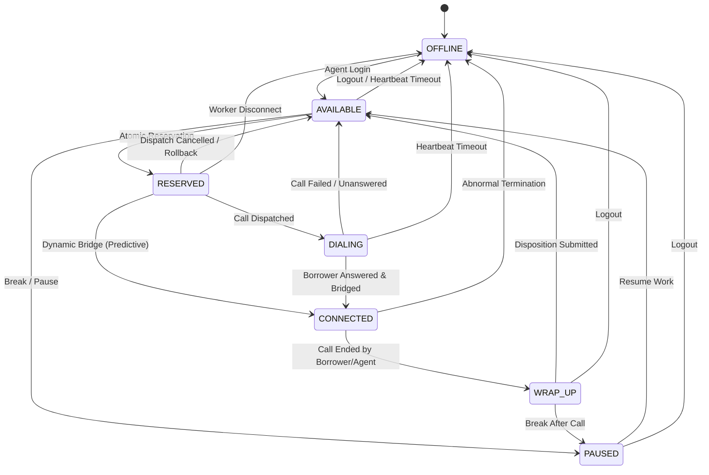

# Agent State Machine Specification

## 1. State Model

Collections agents transition through distinct lifecycle states managed by `AgentStateMachine`:

| State | Description | Can Accept Call? |
|---|---|:---:|
| `OFFLINE` | Agent is logged off or disconnected due to missing heartbeat. | No |
| `AVAILABLE` | Agent is idle and ready to take a call immediately. | **Yes** |
| `RESERVED` | Agent is reserved for an in-flight dialing attempt. | No |
| `DIALING` | Outbound call has been dispatched and telecom leg is ringing. | No |
| `CONNECTED` | Call is active and bridged between agent and borrower. | No |
| `WRAP_UP` | Call finished; agent is completing post-call notes / disposition. | No |
| `PAUSED` | Agent is on break or temporary hold. | No |

---

## 2. Mermaid State Transition Diagram



---

## 3. Concurrency Protection Rules

When multiple dialing workers attempt to reserve the same `AVAILABLE` agent simultaneously:
1. **Atomic Conditional SQL Update:**
   ```sql
   UPDATE agents
   SET status = 'RESERVED', current_call_id = :callId, version = version + 1
   WHERE id = :agentId AND status = 'AVAILABLE';
   ```
2. **Guarantee:** The PostgreSQL engine serializes row-level locks on the agent row. Only **one** worker transaction receives `affected_rows = 1`. All other concurrent workers receive `affected_rows = 0` and immediately back off.
3. This is verified by `AgentConcurrencyTest`, where 10 concurrent threads attempt simultaneous reservation and exactly one succeeds.

---

## 4. Agent Heartbeat Monitoring

- Agents send heartbeats every 10–30 seconds via `POST /api/agents/{id}/heartbeat`.
- The background `DialerScheduler` inspects agents whose `lastHeartbeatAt` exceeds the configured threshold (`smartdialer.heartbeat-timeout-seconds: 45`).
- Any stale agent in `AVAILABLE`, `RESERVED`, or `PAUSED` is immediately transitioned to `OFFLINE`, and their active reservation is released.
