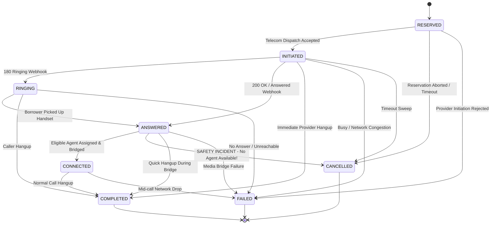

# Call State Machine Specification

## 1. Call Lifecycle States

| State | Description | Terminal? |
|---|---|:---:|
| `QUEUED` | Candidate call identified by dialer. | No |
| `RESERVED` | Call record created; agent and borrower reserved in DB. | No |
| `INITIATED` | Call dispatched to telecom provider; providerCallId assigned. | No |
| `RINGING` | Borrower handset is actively ringing. | No |
| `ANSWERED` | Borrower has picked up the phone handset. | No |
| `CONNECTED` | Call is verified bridged to an eligible assigned agent. | No |
| `COMPLETED` | Call finished normally (hangup or disposition). | **Yes** |
| `FAILED` | Call failed (busy, invalid number, telecom rejection, timeout). | **Yes** |
| `CANCELLED` | Call aborted prior to connection (safety abandon, timeout). | **Yes** |

---

## 2. Mermaid Call State Transition Diagram

---

## 3. Strict Distinction: ANSWERED vs CONNECTED

A common mistake in telephony engineering is treating `ANSWERED` and `CONNECTED` as identical.
SmartDialer explicitly separates them:

- **`ANSWERED`**: The telecom provider signals that the borrower picked up their handset. At this moment, audio is live on the borrower's side, but the agent bridge is not yet established.
- **`CONNECTED`**: The audio bridge between the borrower and an assigned, eligible agent has been successfully confirmed.

### The Zero-Orphan Invariant
> **Under NO circumstances may a call transition to `CONNECTED` unless an eligible, confirmed agent is assigned.**
>
> If a borrower answers (`ANSWERED`), but no eligible agent is available:
> 1. The call **MUST NOT** be marked `CONNECTED`.
> 2. The call is immediately transitioned to `CANCELLED` with reason `SAFETY_ABANDONED_NO_ELIGIBLE_AGENT_AVAILABLE`.
> 3. A safety incident is recorded and telemetry updated.
> 4. The borrower lead is rescheduled with an exponential cooldown period.

---

## 4. Idempotency and Out-of-Order Handling

Telecom networks and webhook dispatchers frequently deliver events out-of-order, delayed, or duplicated. SmartDialer's `CallStateMachine` and `ProviderEventService` handle this deterministically:

1. **Duplicate Webhook IDs:**
   Every event persists `provider_event_id` with a database unique index. Duplicate deliveries return an HTTP 200 with status `DUPLICATE` without executing logic.
2. **Duplicate ANSWERED / COMPLETED:**
   If the call is already in `ANSWERED`, `CONNECTED`, or `COMPLETED`, repeated events are recognized as idempotent no-ops.
3. **Late RINGING after ANSWERED:**
   If a delayed `RINGING` webhook arrives after the call is already `ANSWERED` or `CONNECTED`, it is safely ignored.
4. **Terminal State Regression Guard:**
   Terminal states (`COMPLETED`, `FAILED`, `CANCELLED`) are immutable. An `ANSWERED` event arriving after `COMPLETED` is discarded.
